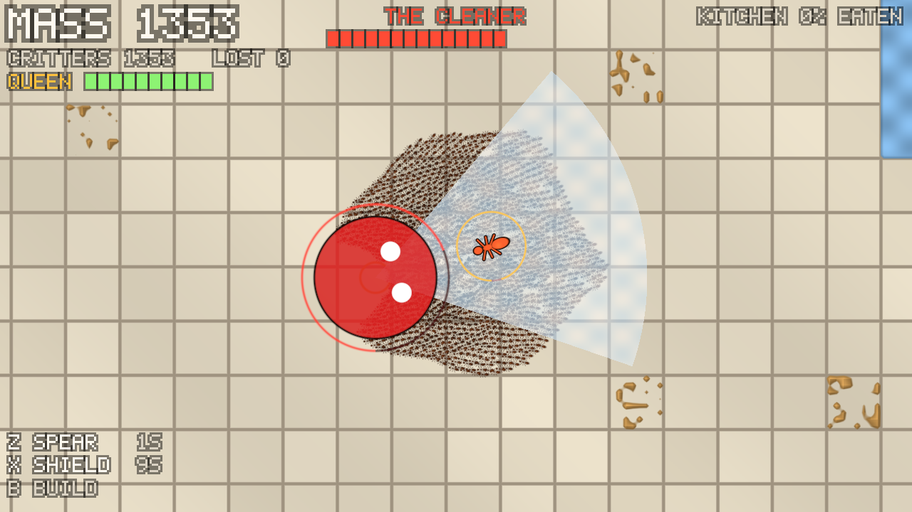

# Myriad

A survivors-like turned inside out: you are the horde. Hatch from ten critters on a kitchen floor, shape the swarm, guard your Queen, and eat your way to a million.

- **Design:** [docs/design/myriad-synthesis.md](docs/design/myriad-synthesis.md), the combined concept.
- **Build plan:** [docs/ROADMAP.md](docs/ROADMAP.md), the major steps, their status, and prompts for continuing in a new session.
- **Playtesting:** [docs/playtest.md](docs/playtest.md), the prototype's exit checklist.



## Run it

You need Rust 1.88 or newer, plus a GPU with Vulkan, Metal or DirectX 12. On Linux, gamepad support also needs `libudev-dev`.

```bash
cargo run --release
```

| Input | Action |
|---|---|
| WASD / arrow keys | Steer the swarm's focal point |
| Left mouse (hold) | Steer toward the cursor |
| Space | Gather (tighten) |
| Shift | Spread (loosen) |
| Z / X | Fire Form slot 1 / 2 (Spear and Shield to start) |
| Q / E | Cycle the Form in slot 1 / 2 (Spear, Shield, Ring, Comet, Bloom) |
| B (hold) | Build: critters bridge water; let go and the bridge drops |
| Enter | Start (from the title screen) |
| R | Restart |
| Esc | Quit |

Eat food to gain mass, and new critters hatch around the Queen. Keep her guarded: if she falls, the run ends. As you grow, the kitchen fights back. Sprays and wiping cloths telegraph their attacks, so spread out or raise the Shield. Swarm them to bite them down, then beat the Cleaner to clear the act. Forms cost mass: a Spear bores through tough food, and a Shield turtles around the Queen. A gamepad works too: the stick steers, the triggers Gather and Spread, A and B fire the Forms, X builds, and the bumpers cycle Forms.

Options: `--agents N`, `--capacity N`, `--seed N`, `--no-threats` and `--dev` (H grants +100 mass). Run `cargo run -- --help` for the full list.

## Headless runs

Headless runs need no window. They're for benchmarks, screenshots and CI: a scripted player tours the kitchen's food, and the run prints timing, mass and swarm stats.

```bash
cargo run --release -- --headless --frames 7200 --screenshot shot.png
```

Add `--threats` for enemies and the Cleaner, `--boss-now` for a boss rush, or `--passive` for a scripted player that never fights. `--bench` times 32,768 critters.

On machines without a GPU, Mesa's software Vulkan driver works (`apt install mesa-vulkan-drivers`).

## Tests

```bash
cargo test
```

GPU tests skip themselves when no adapter is found. Set `MYRIAD_REQUIRE_GPU=1` (CI does) to make that a failure instead.

## Code map

| Path | What it is |
|---|---|
| `src/sim/` | GPU swarm: compute passes (`passes.wgsl`), material grid, async feedback, stats |
| `src/render/` | Floor and food, instanced critters, Queen and threat overlay, bitmap-font HUD |
| `src/level.rs`, `assets/levels/` | ASCII level maps |
| `src/run.rs` | One run's rules: Queen, mop, mass economy, win/lose (pure CPU) |
| `src/game.rs` | Focal point, Gather/Spread, leash, camera targeting |
| `src/colony.rs`, `src/queen.rs` | Mass economy, the Queen |
| `src/threats.rs` | Enemies (spray, cloth, the Cleaner), the Response level |
| `src/forms.rs` | Forms: costs, durations, cooldowns, slots |
| `src/hud.rs` | HUD layout |
| `src/session.rs` | Fixed-timestep loop tying the GPU and the rules together |
| `src/app.rs` | winit window, input mapping, presentation |
| `src/headless.rs` | Windowless runs and PNG capture |
| `tests/gpu_swarm.rs` | GPU integration tests |
