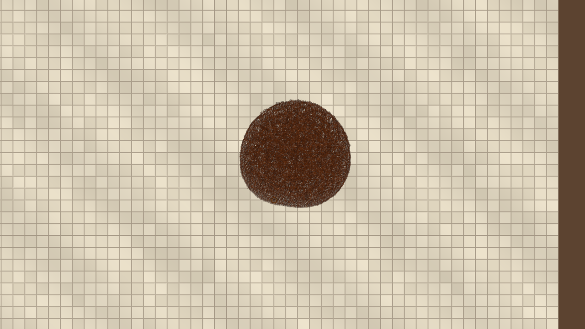

# Myriad

A survivors-like turned inside out: you are the horde. Hatch from ten critters on a kitchen floor, shape the swarm, guard your Queen, and eat your way to a million.

- **Design:** [docs/design/myriad-synthesis.md](docs/design/myriad-synthesis.md), the combined concept.
- **Build plan:** [docs/ROADMAP.md](docs/ROADMAP.md), the major steps, their status, and prompts for continuing in a new session.



## Run it

You need Rust 1.88 or newer, plus a GPU with Vulkan, Metal or DirectX 12.

```bash
cargo run --release
```

| Input | Action |
|---|---|
| WASD / arrow keys | Steer the swarm's focal point |
| Left mouse (hold) | Steer toward the cursor |
| Space | Gather (tighten) |
| Shift | Spread (loosen) |
| H | Hatch 1,000 critters (test key until eating arrives in Step 2) |
| Esc | Quit |

Options: `--agents N`, `--capacity N` and `--seed N`. Run `cargo run -- --help` for the full list.

## Headless runs

Headless runs need no window. They're for benchmarks, screenshots and CI: a scripted figure-eight steers the swarm, and the run prints timing and swarm stats.

```bash
cargo run --release -- --headless --agents 20000 --frames 600 --screenshot shot.png
```

On machines without a GPU, Mesa's software Vulkan driver works (`apt install mesa-vulkan-drivers`).

## Tests

```bash
cargo test
```

GPU tests skip themselves when no adapter is found. Set `MYRIAD_REQUIRE_GPU=1` (CI does) to make that a failure instead.

## Code map

| Path | What it is |
|---|---|
| `src/sim/` | GPU swarm: spatial-hash flocking compute passes (`passes.wgsl`), async feedback, stats |
| `src/render/` | Kitchen floor and instanced critters drawn straight from the swarm buffer |
| `src/game.rs` | Focal point, Gather/Spread, leash, camera targeting (no windowing code) |
| `src/session.rs` | Fixed-timestep loop tying swarm, renderer and game together |
| `src/app.rs` | winit window, input mapping, presentation |
| `src/headless.rs` | Windowless runs and PNG capture |
| `tests/gpu_swarm.rs` | GPU integration tests |
